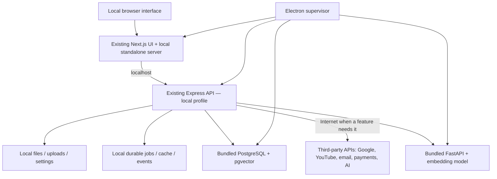

# Dozu monorepo and local-first desktop plan
**Current v1 amendment (2026-11-11):** [speech-to-text removed; PostgreSQL retained; pgvector deferred](v1-scope-2026-11-11.md). Retained PDF/YouTube reference retrieval uses a separate text-embedding model, so its smaller-runtime proof remains relevant. This amendment supersedes older speech/extension packaging requirements below; no runtime pass is implied.
Date: 2026-11-09
Revision: 3 — authoritative interpretation of the user's latest clarification.
Status: implementation plan; application source has not yet been migrated.
Target: https://github.com/Do-Zu/dozu

Task #2 decisions agreed 2026-11-10: [full page matrix](feature-preservation.md), [v1 platform/hardware/installer/resource contract](platform-support.md), [LAN classrooms and explicit payment deferral under #41](integration-decisions.md). These decisions supersede earlier unresolved topology/merchant wording below. Payment execution is deferred, not deleted; remote internet classrooms are not a v1 requirement. Targets need measured proof; SQLite remains evaluation-only pending compatibility validation.

## Required architecture
- Preserve the complete existing Next.js application: all pages, layouts, UI components, navigation, locales, roles, and features. Retain the website build.
- Package the existing Express backend and business logic on each user's computer. No centrally hosted Dozu application backend is required.
- Store application records, accounts, progress, settings, jobs, and uploaded/generated files in a local database and local filesystem. Each installation is the primary source of truth for its own data.
- Desktop and any local browser interface communicate with the same local backend through localhost.
- Internet access is allowed for real third-party integrations, including Google OAuth, YouTube, email, payments, and configured AI providers. Local backend does not imply internet isolation.
- Preserve integrations wherever technically feasible. Do not replace them with fake offline transactions, simulated sign-in, or local-only substitutes without an explicit product decision.
- Do not introduce a cloud database, cloud synchronization, or an operator-maintained central application server.
- Installation supplies Node/runtime capability, backend, database, required local services, resources, and migrations. Users do not manually install or configure Node, PostgreSQL, Python, Redis, Docker, WSL, or development tools.
- Core local application startup and local-data workflows work without a Dozu server. Features that need third-party connectivity or user credentials report those specific requirements; they do not prevent unrelated local use.
- Uninstall offers a tested choice to retain data or permanently delete all app-owned local data on Windows, macOS, and Linux.

This revision supersedes both the original remote-backend proposal and the short-lived fully air-gapped interpretation. A reduced set of screens is not the release target. Universal first-use offline operation for external services is not required.

## Recommended stack
| Layer | Recommendation | Rationale |
| --- | --- | --- |
| Shell | Electron + TypeScript | Supplies Chromium and process supervision while retaining the complete Next.js application |
| Frontend | Current Next.js App Router standalone server | Preserves routes, server message loading, middleware, components, and navigation; avoids a second Vite frontend |
| Backend | Current Express/TypeScript service with a local runtime profile | Reuses controllers/services/repositories and selects local storage, jobs, secrets, and callback configuration |
| Database | Bundled PostgreSQL + matching pgvector extension | Existing Drizzle pg-core models use JSONB, PostgreSQL SQL, vector(384), cosine distance, and HNSW; SQLite is not a drop-in behavior-preserving replacement |
| Jobs/cache/events | Persistent PostgreSQL jobs + bounded process-local cache/pubsub adapters | Avoids requiring Redis/WSL on Windows while preserving durable retries, scheduling, recommendations, counters, and UI events |
| Embeddings | Bundled Python/FastAPI + pinned CPU-capable sentence-transformers runtime and model | Retains the existing embedding service and 384-dimensional contract with local storage/processing |
| Generative AI | Preserve existing provider interfaces and third-party API integrations | Use user-owned/scoped credentials stored locally; no shared vendor secret embedded in the installer |
| Files | Local app-owned filesystem, DB metadata, authenticated local file/upload endpoints | Replaces required R2/S3/Cloudinary storage while preserving file workflows and external content ingestion |
| Distribution | Electron packaging with signed platform installers and bundled resources | Owns local runtime lifecycle and install/upgrade/uninstall |
| Monorepo | pnpm workspaces + Turborepo; uv for Python | Unifies sources and builds without forcing Python into the JS package manager |

Electron utilityProcess is a candidate for Next.js/Express workers. Validate it in a packaged proof; bundle a pinned standalone Node runtime if required by compatibility. Either approach ships the runtime. No system Node dependency.

The shell recommendation is subject to that proof. The local ownership/runtime architecture is fixed. The former Tauri + separate React/Vite frontend proposal is superseded because retaining the complete Next.js application is the priority.

## Runtime architecture


Use one local UI origin and proxy /api, local files, Socket.IO, and streaming to the local API where feasible. Discover loopback ports at runtime; compiled NEXT_PUBLIC_API_URL strings must not select a hosted backend. Audit every client, not only Axios.

Share backend code, not a remote backend instance. Each installation runs its own Express and database. A local browser uses that same running instance. Retain website code/build/deployment capability separately; desktop operation does not depend on a website deployment.

## Repository layout
```text
apps/
  web/                       complete existing Next.js app; also packaged for desktop
  api/                       current Express app with explicit runtime/provider profiles
  desktop/                   Electron main/preload, supervisor, installer/uninstaller hooks
services/
  embedding/                 current FastAPI service
packages/
  runtime-contracts/         readiness, process, port and compatibility contracts
  local-runtime/             local bootstrap, jobs, files, cache and provider adapters
  api-contracts/             portable request/response types where actually reused
  config/                    shared tooling
resources/
  manifests/                 per-platform binary/model/license/checksum manifests
infra/                       development tooling and retained website deployment definitions
docs/
  requirements/
  architecture/
  integrations/
  releases/
```

Keep route-scoped features in their current boundaries. Extract only useful shared modules; do not rewrite/extract the entire UI to populate packages. Release CI assembles approved binaries/models; Git stores manifests and source, not developer secrets, databases, caches, or node_modules.

## Findings from the source audit
- Completed #3 audit: [evidence and independent baselines](audit/README.md), [84-page matrix](audit/feature-parity.md), [findings](audit/findings.md). The runtime proof must additionally cover Gotenberg/LibreOffice, Puppeteer browser resources, whisper.cpp/tiny model/FFmpeg, ignored migration history and existing UI build/embedding contract failures. The current recommendation remains conditional on #4; audit completion does not establish runtime parity.
- Next.js already has standalone output, dynamic routes, locale middleware, and a server-marked message loader. Copy public and .next/static resources alongside the traced server output, including monorepo dependencies.
- The database uses PostgreSQL-specific Drizzle definitions, vector(384), JSONB, vector casts, cosine distance, and HNSW indexes.
- Express initializes Socket.IO, scheduling, and database connections. Its current listen(port) call does not explicitly bind the configured host; the local profile must bind explicitly.
- Redis consumers cover queues, pubsub, recommendations, frequency counts, payment state, and sockets. A queue-only replacement would be incomplete.
- Uploads use R2/S3; images use Cloudinary/Unsplash; generation can use AWS Lambda and external LLM APIs. Keep third-party data processing where allowed, but persist application-owned files, records, and job state locally.
- Google code currently exchanges a web-app authorization code using GOOGLE_CLIENT_SECRET and a frontend redirect path. It needs an installed-app flow.
- PayOS uses merchant API/checksum keys, webhook-driven updates and Redis mappings. Its getPaymentStatus method is not implemented; an existing web checkout check-status URL is not proof of an authenticated merchant reconciliation path.
- SMTP is configured as a server-side mail transport. A shared publisher SMTP password cannot safely be distributed in desktop software.
- Embedding model startup can fall back to a Hub model name. Bundle the baseline model and load local paths; do not require a model download to start the local stack.
- Remote images, a YouTube proxy rewrite, and provider URLs need targeted adaptation, not a blanket internet ban. next/font/google normally emits self-hosted build assets; bundle the emitted font files and other assets.
- Node scripts contain Windows-only environment assignment; Python dependencies are unpinned.
- route-inventory.json records 84 page entrypoints, 20 layouts, and 164 TSX files under src/components at the inspected UI commit. Route-scoped components/hooks/providers are additional and remain in scope. Static counts are not proof of feature parity.

## Integration compatibility and secure solutions
| Integration | Preserve | Desktop-compatible design | Limitation / decision |
| --- | --- | --- | --- |
| Google OAuth | Real Google sign-in and existing local account/roles | Installed-app client, system browser, PKCE/state/nonce, short-lived loopback callback, validate token issuer/audience and map identity to local records | Register the proper client/consent configuration; installed apps cannot hold confidential web-client secrets |
| YouTube/URL ingestion | Real network fetch, transcript/video metadata and existing media UI | Calls from local backend using provider rules; persist user-authorized material/metadata locally; preserve local file workflows | New remote content needs internet; rate limits, quotas, cookies and provider restrictions still apply |
| Email | Real SMTP/provider delivery | User-owned SMTP credentials or provider-supported delegated authorization stored in the OS credential store; local retry/status records | Shared Dozu mailer credentials cannot be shipped; delivery and externally addressed password links require a return-path design |
| Payments | Real provider checkout, transaction status and history | User-owned merchant integration where appropriate; provider checkout in system browser; authenticated provider status query/reconciliation into local DB; validate amount/currency/order/account | A customer must never receive Dozu's merchant secret. Seller-owned checkout/licensing needs a provider-managed product/signed entitlement or another explicit solution, not a secret in every installer |
| Webhooks | Existing verified provider events where needed | Prefer provider-supported outbound reconciliation if semantics permit; otherwise an opt-in user-owned public endpoint/tunnel terminating a narrowly scoped authenticated callback | Providers cannot reach 127.0.0.1; host must be awake for a live tunnel. Durable delivery may require provider-managed retention; do not promise reliability without proof |
| Classroom | Existing teacher/student pages, roles, quizzes, assignments, records and live events | Same local backend for local windows/browser sessions; investigate explicit authenticated LAN or user-owned reachable host/tunnel for remote participants | Separate installations do not magically share classroom state. No cloud sync is introduced. Remote access, ownership, TLS/auth, NAT and host availability need explicit design/approval |
| LLM APIs | Existing generation/provider/model settings and genuine responses | Direct calls from the local Express backend using scoped user-owned API credentials; persist application content locally | Provider sees submitted prompts/documents. Vendor-paid shared keys need provider delegation/user billing or a service; do not smuggle in a central Dozu proxy |
| R2/S3/Cloudinary | Existing upload/download/avatar/editor attachment behavior | Implement local storage adapters and localhost file URLs; retain external image discovery where useful | Required application storage remains local; downloading/importing content is different from cloud persistence |
| AWS Lambda generation | Existing generation workflow and output contracts | Execute job handlers in the local worker, retaining permitted outbound provider calls | Do not require a Dozu-owned cloud compute function just to run the backend |
| Feedback and external links | Genuine outbound behavior where feasible | System browser or a configured third-party destination, with local submission state | Do not fake remote delivery or make core use depend on a central app service |

An API secret in a distributed binary or in a database controlled by the user is not a protected publisher secret. The local backend protects user-scoped credentials from casual renderer access; it cannot keep shared merchant/vendor credentials confidential from the machine owner. Use public/native clients, user-owned credentials, and supported provider delegation.

Historical audit constraint, superseded for v1 by explicit payment deferral under #41 (ownership stays deferred): is this a merchant self-hosting their own payment channel, or a customer paying Dozu for an entitlement? Preserve pages in either case; select and verify the real provider flow before claiming the feature works. Webhook/public callback needs and remote classroom sharing are feasibility gates, not reasons to silently remove those features.

## Local database, jobs and bootstrap
Bundle PostgreSQL, pgvector, migration/backup utilities and required dynamic libraries per OS/architecture. Create a private per-user cluster and generated local credentials; do not install a global service. Handle PostgreSQL's Unix non-root constraint and Windows per-user permissions. Bind loopback ports, verify readiness, apply migrations/seed roles/configuration, then launch workers/API/UI.

Replace desktop Redis/BullMQ consumers through a reviewed adapter boundary. Persist delayed jobs, retries/backoff, progress, payment mappings, schedules and idempotency keys locally. Restore pending work after a crash without double processing payments or study updates. Recompute only genuinely disposable caches; preserve durable counters/recommendation inputs.

Local runtime startup must not initialize missing remote providers in module-global constructors or throw because an optional third-party API key is absent. Configure integrations in-app, lazily, with clear per-feature status. No manual backend/database setup.

## Local assets, embeddings and external AI
Bundle Next.js public/static files, fonts, PDF workers, icons, baseline images, converters and necessary rendering resources. Missing remote decorative assets must not break navigation or local data. Keep YouTube/external images/provider calls where part of a real integration.

Bundle the FastAPI runtime and baseline embedding model/tokenizer/configs at pinned revisions, loading verified local paths. CPU baseline is required; GPU acceleration must not require manual setup to use the app.

Generative AI may continue to call configured internet providers. Do not impose a new multi-gigabyte local LLM requirement or substitute low-quality local generation without a product decision. Local model support can be another explicitly requested capability; it is not required by the latest architecture. Persist prompts, outputs and study records locally, with explicit user-visible external processing when the feature sends content.

## Data ownership and uninstall
Use a documented app-owned local data root: non-roaming local app data on Windows, Application Support on macOS, and suitable local XDG directories on Linux. Keep database/WAL, files, jobs, accounts, settings and generated content local. Inventory logs/caches/temp files, Electron browser storage, secrets, model overrides, backups and installer/update staging as well.

Keep immutable resources separate from mutable user data. Backups are user-controlled local file exports/imports, not synchronization. Capture DB/files consistently, validate integrity/schema versions, and confirm overwrites.

Every delivered uninstall flow must provide Keep data or Permanently delete app data. DMG drag-to-trash and AppImage removal alone do not provide that choice; design a platform-appropriate uninstall/cleanup companion or integrated pre-uninstall workflow. Stop owned processes, validate exact app roots, remove owned files/stores/keychain entries, handle permissions/locks, and report incomplete deletion. Do not delete unrelated files or user-selected exports outside app ownership. Permanent logical deletion cannot guarantee forensic erasure from snapshots/SSD history.

## Lifecycle, networking and security
Single-instance supervisor owns process IDs, dependency readiness, local credentials, ports, service versions, crash recovery and graceful shutdown. Start data root/config → DB/migration/seed → workers/embedding → API → Next server → window. Include diagnostics for port conflicts, corrupt DB, low disk/RAM, interrupted first boot and permissions.

Bind services to loopback by default, explicitly. Strict Host/Origin checks, CSRF/local session controls, validated IPC and constrained local file endpoints protect localhost from arbitrary websites and unauthenticated local clients. Use context isolation, renderer sandboxing and no renderer Node integration.

Allow deliberate third-party requests. Test that no application request, database connection or upload silently goes to a legacy hosted Dozu service or cloud storage. Verify redacted logs and scoped secure credential persistence. Do not implement a global network block that breaks preserved integrations.

Public exposure, tunnels and LAN access are opt-in feature decisions. Do not bind the whole API/database to 0.0.0.0 merely to receive a webhook. If external reachability is chosen, expose only the required authenticated service routes, with TLS, explicit permissions and lifecycle ownership.

Support optional signed update distribution and manual signed installer/package updates. Neither startup nor local data access requires an update server. Database migrations need consistent backup/recovery and version compatibility; retain data during upgrades unless the user chooses deletion.

## Delivery phases and release gates
| Phase | Work | Exit evidence |
| --- | --- | --- |
| 0 Requirements/audit | Record latest mandate, inventory every route/role/provider and public-callback/shared-secret limitations, choose OS/CPU baseline | Feature matrix covers the complete UI; integration gaps and decisions are explicit |
| 1 Monorepo/runtime proof | Import sources, preserve website build, bundle Next/Express/Postgres/pgvector/FastAPI/model, validate supervisor | Clean-machine install and local workflow without manual setup or central Dozu service |
| 2 Local services/integrations | Local files/jobs/accounts/secrets, Google native flow, YouTube/email/AI/payment adaptation, classroom reachability design | Real integrations tested where feasible; local data is authoritative; no shipped shared secrets |
| 3 Full feature parity | Every page/component/navigation and role/locale workflow, local browser reuse, disconnected recovery | No reduced feature subset; full matrix has evidence or explicit unresolved technical blockers |
| 4 Distribution/data lifecycle | Signed installers, upgrade/backup/restore, support runbooks, uninstall keep/delete choice | Windows/macOS/Linux clean-machine, data retention/deletion and integration failure tests pass |

The early proof is an engineering milestone; it does not reduce the required release scope.

## Required verification
1. Install on clean machines with no developer runtimes/database/Docker/WSL. Launch the complete local stack without manual configuration.
2. Verify first-party data access and writes use localhost/local DB/files; stop any legacy hosted Dozu endpoint and confirm local use.
3. Desktop and local browser see the same records through the same local backend. Separate installations are independent.
4. Execute every route/role/locale/feature matrix row, including all admin/teacher/student/navigation flows.
5. Test internet-dependent features against real provider/sandbox flows using scoped credentials; verify OAuth replay/nonce, payment reconciliation/idempotency/signatures, SMTP delivery, YouTube errors/quotas and AI streaming.
6. Disconnect internet: unrelated local use and persisted data remain available; relevant external actions show honest errors/retry/cancel without faking success.
7. Verify no app/database/storage synchronization and no application-owned cloud storage dependency. External providers receive only data required by the requested feature, according to its configuration.
8. Crash/restart/sleep, port conflict, update/migration failure, local backup/restore and data ownership tests pass.
9. Test both uninstall choices per installer/OS, including credentials, caches, logs, files and partial-deletion reporting.
10. Existing website build and regression checks pass alongside the desktop build.

## Backlog publication
Issues #1–#26 were revised in place, preserving URLs and labels. Issues #27–#44 add local database/pgvector, supervisor/bootstrap, queue/cache replacement, secure provider credentials, integration feasibility, payments/email/classroom behavior, resource packaging, local browser support, data lifecycle and network/data-ownership acceptance. All 44 titles/bodies/labels and dependency links were read back and verified; the roadmap links all 43 child items. There are 4 ticket items and 40 task items. This verifies planning publication, not completed application implementation.
No synchronization work is planned. Labels: ticket = architecture/product/delivery outcome; task = concrete implementation/verification. Dependencies encode execution order, not optionality.

## Primary references
- Next.js standalone and assets/tracing: https://nextjs.org/docs/app/api-reference/config/next-config-js/output
- Electron utilityProcess: https://www.electronjs.org/docs/latest/api/utility-process
- Electron security: https://www.electronjs.org/docs/latest/tutorial/security
- PostgreSQL initialization: https://www.postgresql.org/docs/current/app-initdb.html
- pgvector: https://github.com/pgvector/pgvector
- Google desktop OAuth: https://developers.google.com/identity/protocols/oauth2/native-app
- Native OAuth best practice: https://www.rfc-editor.org/rfc/rfc8252
- PayOS API: https://payos.vn/docs/api/
- Transformers local model loading: https://huggingface.co/docs/transformers/installation#offline-mode
- Redis Windows installation constraints: https://redis.io/docs/latest/operate/oss_and_stack/install/archive/install-redis/install-redis-on-windows/

